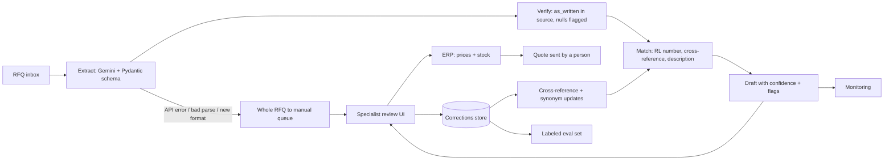

# Ridgeline Quote Desk

## Repository

https://github.com/m-sabih/fullstack_fde_challenge

## How to Run

Python 3.13+, Gemini on Vertex AI with application default credentials (no API key).

```bash
pip install -r requirements.txt
gcloud auth application-default login
cp .env.example .env          # fill in GOOGLE_GENAI_USE_VERTEXAI, GOOGLE_CLOUD_PROJECT, GOOGLE_CLOUD_LOCATION, GEMINI_MODEL

python run.py                 # all six RFQs -> outputs/<rfq>.json
python run.py path/to/rfq.pdf # a single RFQ
python evaluation/evaluate.py # metrics + evaluation/results.json (only script that reads answer_key/)
python tests/test_extract.py && python tests/test_match.py   # offline checks, no LLM
```

## Approach

**One decision matters most: never guess.** A wrong part number that looks confident is worse than a flagged line, because the specialist trusts it. Every line carries a confidence score and flags; anything uncertain is sent to review instead of being filled in.

**Extraction** (`pipeline/extract.py`)
- One LLM call per RFQ with a strict Pydantic schema (`response_schema`), temperature 0. No per-format templates, so a new layout doesn't break it (the RPA bot's failure mode).
- Text is sent as text, PDF and PNG as native file parts, Excel converted to tab-separated text (Gemini doesn't read xlsx).
- The model returns `null` for anything not explicit (quantity, unit) and adds a flag. "Same as last order" is flagged, never matched. Forwarded chains apply the later edits, recorded in `note`.
- Guards in code, not in the prompt: every `as_written` must appear in the source text (`not_in_source` otherwise); line numbers come from `enumerate`, not the model; API failures give a single `extraction_failed` line for the whole RFQ.
- The photo (rfq_04) is fully extracted, but every line is forced to review (`source_photo`).

**Matching** (`pipeline/match.py`): deterministic, in this order:
1. Ridgeline part number found in `products.csv`: confidence 0.99.
2. Cross-reference sheet: 0.95, minus 0.15 when the sheet has a note ("close sub", "check thickness"), minus 0.05 when never verified; a competitor number that maps to two parts drops to 0.4.
3. Description match: token scoring where sizes and codes (6204, 2RS, 1/2-13, 20x20x2) dominate and words scale the score; a close runner-up lowers confidence and flags `ambiguous_match`. A small synonym table (sealed = 2RS, bolt = cap screw, gr5 = grade 5) is the tuning knob.
4. Below 0.5: no match, flagged `not_carried`.

After matching: discontinued parts follow `replaced_by` (flag `discontinued_replaced`, confidence capped at 0.7); the RFQ unit is checked against the catalog unit; a missing unit is filled from the catalog only when it's EA or the customer used our part number (otherwise "300 bolts" could become 300 boxes).

**Guardrails:** the pipeline never outputs prices (pricing and stock stay in Ridgeline's systems), and it only writes drafts: a person approves every quote.

**Model and region:** Gemini (`gemini-3.1-flash-lite`) on Google Vertex AI. The demo uses the `global` endpoint; this does not meet the "data stays in the US" constraint. Production pins `GOOGLE_CLOUD_LOCATION` to a US region (e.g. `us-central1`), a config change only.

**Skipped:** an LLM fallback for matching (an LLM re-ranker choosing from the top 10 description candidates). The review queue covers it for now.

## Evaluation

`evaluation/evaluate.py` joins `outputs/` to the three answer keys on line number (19 lines).

- **Extraction accuracy:** share of answer-key lines where quantity and unit both match.
- **Match precision:** of lines where we proposed a part, share that is correct.
- **Match recall:** of lines that have a correct part, share we found.
- **Additional metrics:** accuracy by match method, whether lines with no correct part were flagged instead of guessed, and a threshold sweep showing auto-accept precision (lines that skip review and are correct) and review rate (specialist workload).

**Results:** extraction 1.0, precision 1.0, recall 1.0, 2 of 2 no-match lines flagged. These are optimistic: the synonym table and scoring were tuned on these same RFQs, and 19 lines is a small sample.

**Threshold: 0.8.** Every threshold from 0.5 to 0.95 had zero wrong auto-accepts, so the data alone can't choose. The cost is asymmetric: a wrong part in a quote costs a sale or a return, a needless review costs about 30 seconds. At 0.8 only exact Ridgeline numbers (0.99), clean cross-references (0.9 to 0.95) and near-exact description matches (0.85) skip review; 47% of lines go to review. Lower it once reviewer data shows description matches hold up (0.65 would cut review to 32% on this sample).

**Growing the labeled set:**
- Pair Ridgeline's past RFQs with the quotes actually sent: the sent quote is the label (final part numbers and quantities).
- Every reviewer correction after launch becomes a labeled line.
- Sample across formats, customers and competitors, and keep a fixed test set that is never used for tuning.

## Production



**When extraction fails or a new format appears**
- API errors retry twice, then the whole RFQ goes to the manual queue as `extraction_failed`; nothing is dropped.
- Unknown file types get the same treatment. A new layout of a known type needs no code change: no templates.
- A spike in `not_in_source` or null quantities for one sender points to a new format; add a sample to the eval set.

**Monitoring and alerts**
- Per day: extraction failure rate, review rate, reviewer override rate per match method, share of `not_carried`.
- Alert when extraction failures go above 5%, the override rate on auto-accepted lines goes above 2% (wrong parts slipping through), or the review rate jumps by 20 points (a new format or catalog change).

**Cost and latency per RFQ**
- One flash-lite call per RFQ: a few thousand input tokens and about 1k output tokens, well under 1 cent. Matching is local and instant.
- Measured: about 3 seconds per RFQ (six RFQs in about 16 s, run one after another). 400 RFQs a week is under $5 a week.

**How reviewer corrections improve the system**
- Each correction is stored with the line, the proposed part and the approved part.
- A confirmed competitor-to-Ridgeline mapping goes into the cross-reference sheet, so the next time it's an exact lookup.
- Repeated wording fixes go into the synonym table. All corrections join the eval set, and the threshold is re-tuned from it.

**With two more weeks**
- An LLM re-ranker over the top 10 description candidates, measured against fuzzy-only in the evaluation.
- Order history access, to resolve "same as last order".
- BM25 or embedding retrieval for the full 40,000-product catalog.
- A US-region endpoint, a simple review UI and a few hundred labeled lines from past quotes.
